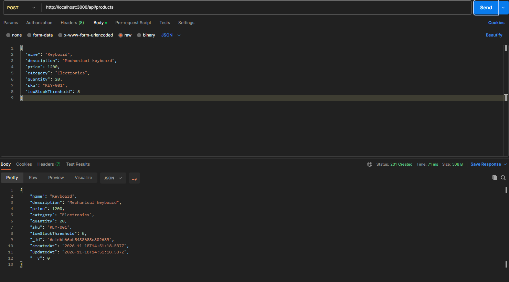
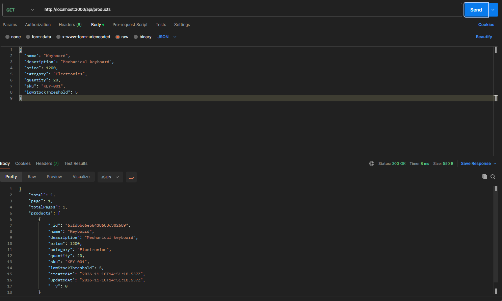
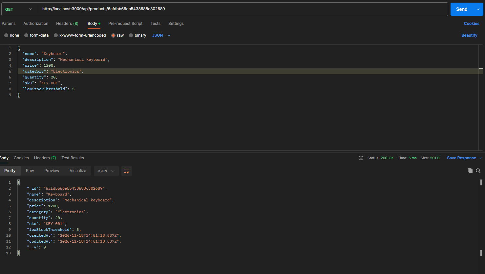
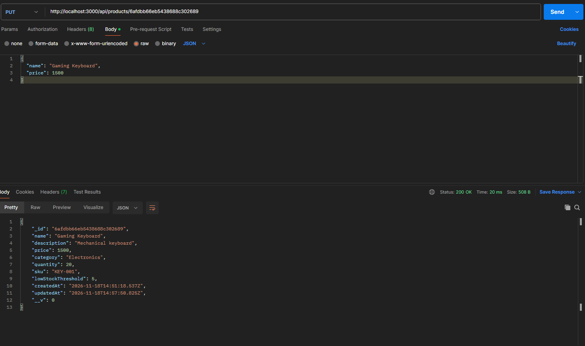
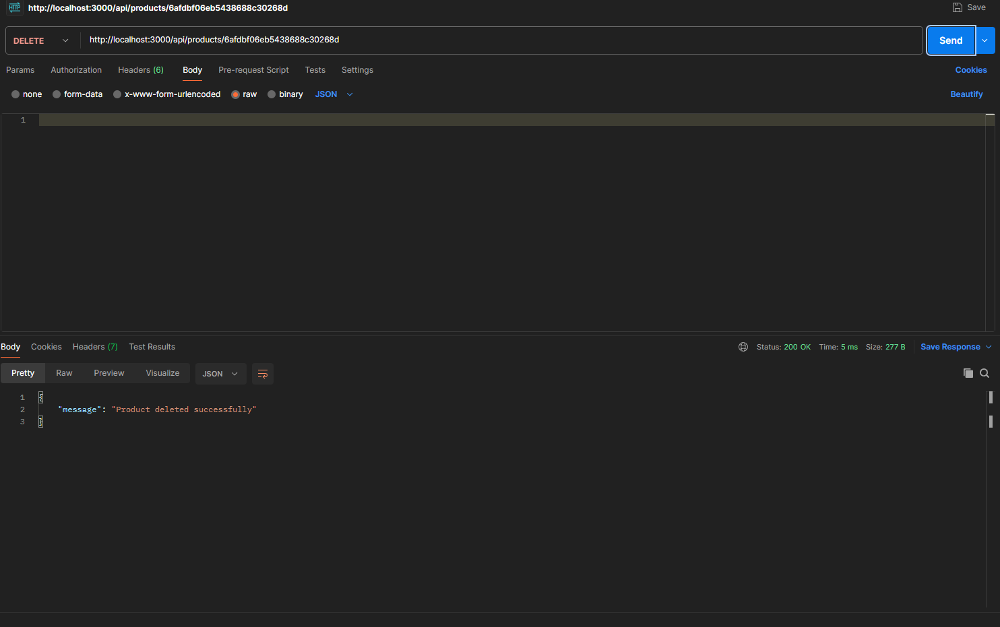
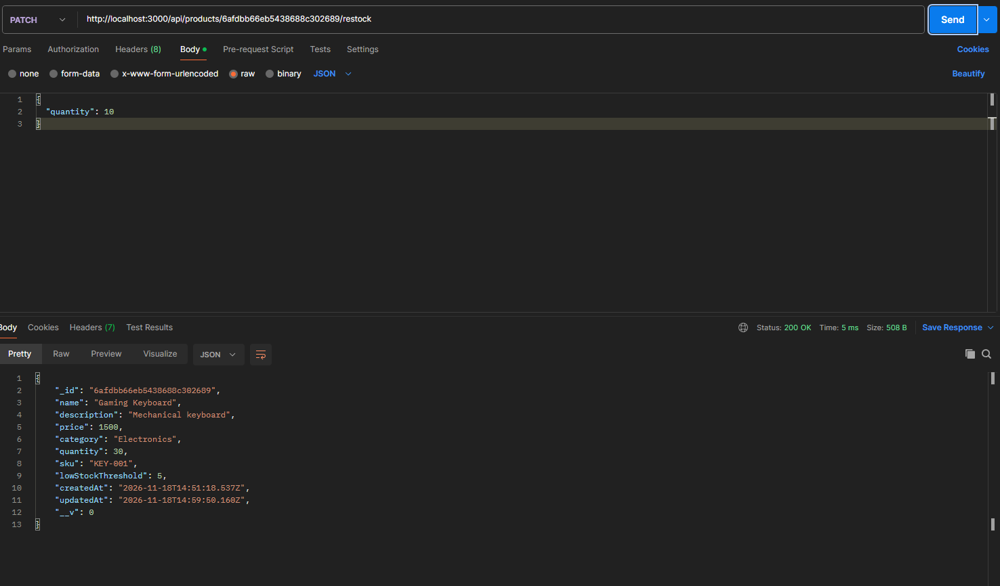
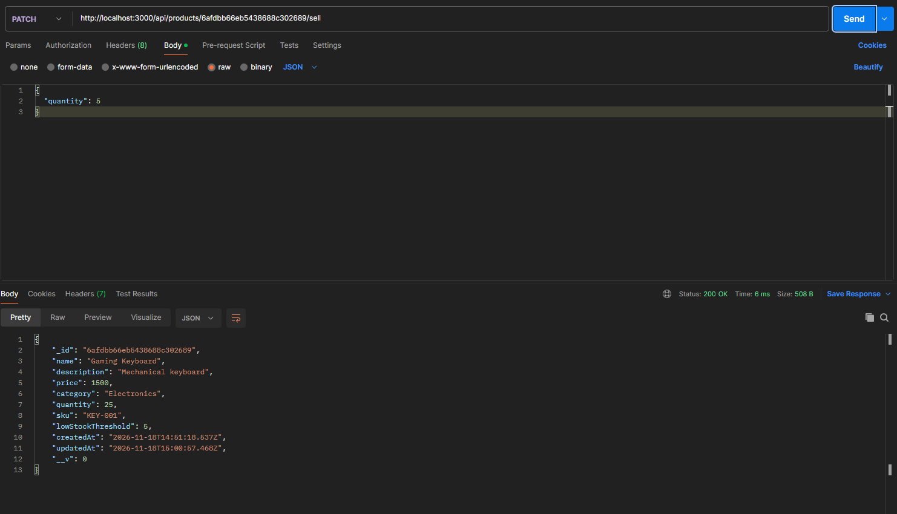
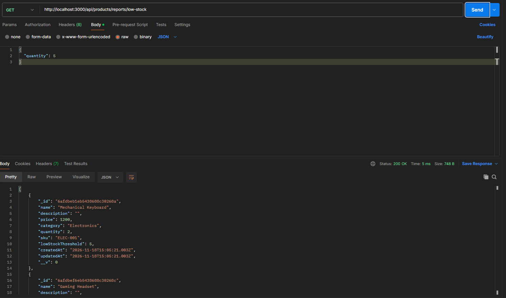
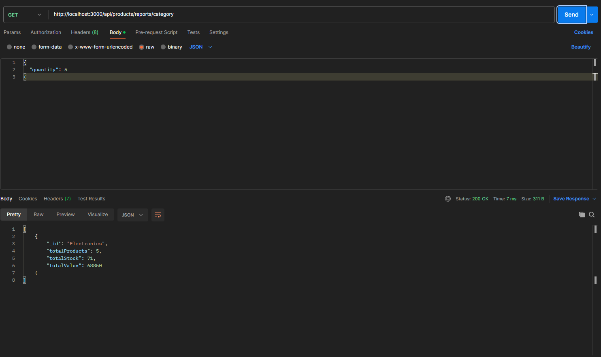

# Inventory and Data Management System

A RESTful backend application built using **Node.js, Express.js, MongoDB and Mongoose** to manage product inventory, stock levels, product categories and inventory reports.

## Project Information

| Description |
|---|---|
| Assignment | Assignment 3 |
| Course | Web Development III |
| Unit | Unit 3 |
| Project Type | Backend REST API |

## Features

- **Product Management:** Create, retrieve, update and delete products.
- **Schema Validation:** Validate product fields using Mongoose.
- **Filtering and Searching:** Filter by category, product name and price range.
- **Sorting:** Sort products by name, price, quantity and creation date.
- **Pagination:** Retrieve products in manageable pages.
- **Stock Management:** Perform restock and sale operations.
- **Low-Stock Alerts:** Identify products below their stock threshold.
- **Inventory Reports:** Generate category-wise product and stock summaries.
- **Error Handling:** Centralized error-handling middleware.

## Technology Stack

- Node.js
- Express.js
- MongoDB
- Mongoose
- dotenv


### 4. Start the server

```bash
node server.js
```

The server will run at:

```text
http://localhost:3000
```

## Screenshots

All screenshots below demonstrate the working Inventory Management System APIs tested using Postman.

### 1. Create Product


### 2. Get All Products


### 3. Get Product By ID


### 4. Update Product


### 5. Delete Product


### 6. Restock Product


### 7. Sell Product


### 8. Low Stock Report


### 9. Category-wise Inventory Report

